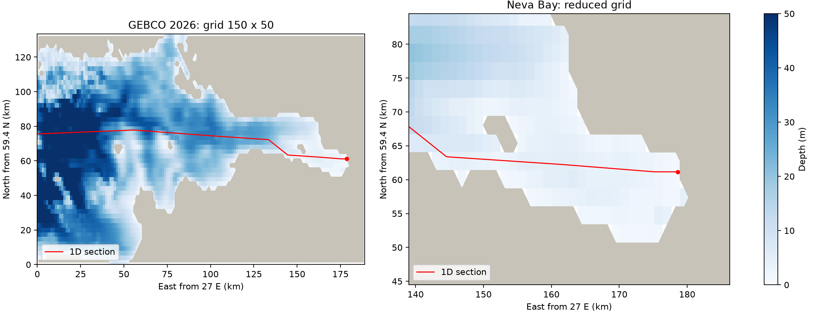
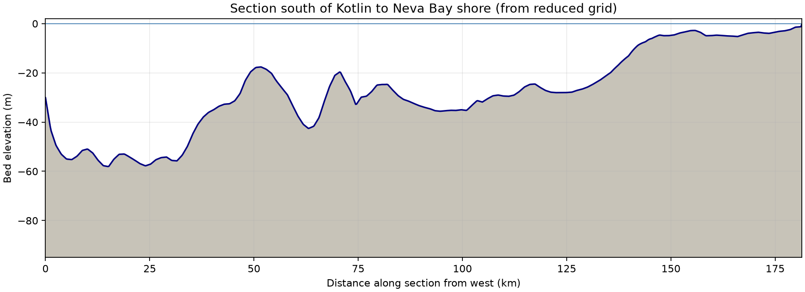

# Финский залив: глубины, волны и исторические наводнения

Здесь собраны данные для расчёта распространения волн из восточной части
Финского залива через район Кронштадта к берегу Петербурга: карта и профиль
дна, глубины, оценки уклона, наблюдения волн и сведения о наводнениях.
У каждого набора указаны источник и место, к которому он относится.

## 1. Карта глубин и профиль дна

Источник — **GEBCO 2026**, область 27–30,4° в. д., 59,4–60,6° с. ш.
Исходная сетка имеет шаг 15 угловых секунд. Подготовленная карта содержит
150 × 50 ячеек; глубины заданы в метрах, суша обозначена нулём.
[Документация GEBCO][gebco], [DOI набора][gebco-doi].

| Файл | Что содержит |
|---|---|
| `data/gulf_bathymetry.npz` | `x` — 150 координат с запада на восток; `y` — 50 координат с юга на север; `h` — глубины формы (50, 150), порядок `h[iy, ix]`. Координаты в метрах. |
| `data/gulf_profile.npz` | `x` — расстояние вдоль разреза в метрах; `h` — глубина. По 801 значению; длина разреза 181,42 км. |

Координаты карты отсчитываются от юго-западного угла (27° в. д., 59,4° с. ш.)
в локальной цилиндрической проекции с опорной широтой 60°; они относятся
к центрам ячеек. Координата `x` профиля имеет другой смысл — путь вдоль разреза.

Разрез проходит от западной колонки карты южнее Котлина через Невскую губу
к берегу Петербурга. Глубины получены интерполяцией той же карты. Маршрут
сохранён в профиле в массивах `lon`, `lat`, `map_x`, `map_y`.
Последний узел имеет h = 0 и обозначает условную береговую границу;
до него пересечений суши в исходной и уменьшенной масках нет.

**Защитную дамбу не моделируем.** В используемой сетке она не образует
непрерывного сухого барьера, поэтому дополнительная коррекция глубин не
применялась. Котлин и водное сообщение с Невской губой сохранены.
Это приближённая геометрия без защитного сооружения, а не восстановленная
карта исторического дна: берега, намывные территории и каналы разных лет
не реконструированы.

## 2. Глубины и уклон у берега

| Величина | Значение | Откуда получено |
|---|---|---|
| Преобладающие глубины Невской губы | 3–5 м; средняя около 4 м | [Голубков, Балушкина, 2024, с. 49][depth-paper] — описание района исследования |
| Глубины на контрольном участке подготовленной карты | медиана 3,82 м; диапазон 2,84–5,20 м | расчёт по GEBCO: 18 водных ячеек в пределах 29,95–30,15° в. д., 59,92–59,98° с. ш.; это не среднее по всей губе |
| Глубина в начале разреза | 30,08 м | подготовленный профиль GEBCO |
| Наибольшая глубина вдоль разреза | 58,04 м | подготовленный профиль GEBCO |
| Средний уклон на участке от 10 до 1 км до берега | 2,50·10⁻⁴, примерно 1:4000 | расчёт по профилю: уменьшение глубины с 3,61 до 1,36 м за 9 км |
| Средний уклон на участке от 12 до 2 км до берега | 1,97·10⁻⁴, примерно 1:5080 | расчёт по профилю на другом интервале для проверки зависимости от выбора участка |

Уклон вычислен как разность глубин на концах участка, делённая на его длину.
Это оценка по батиметрии GEBCO, **не прямое измерение пляжного откоса**.
Источник независимых промеров уклона у конечной точки разреза не найден.
Последний километр с условной береговой границей в эти оценки не включён.

## 3. Высоты и периоды волн

Hs — значительная высота нерегулярных волн, Hm — максимальная высота
отдельной волны, Tp — пиковый период спектра. Эти величины относятся
к волнению, а не к максимальному подъёму уровня при наводнении.

| Где и когда | Высота волн | Период | Источник |
|---|---|---|---|
| Летипеа, южное побережье залива, 23.11.2008 | Hs = 3,7 м | Tp достигал 9,3 с | [Suursaar, 2010, § 3.4, с. 409][waves-2010] |
| Силламяэ, наблюдения 29.07–10.09.2009 | максимум Hs = 1,3 м; Hm = 2,1 м | в таблице не указан | [Suursaar, 2010, табл. 1, с. 394][waves-2010] |
| Буй у Наиссаара, Финский залив, шторм 09.01.2005 | измеренный максимум Hs = 4,5 м | наблюдавшийся Tp был около 12 с примерно 10 часов | [Soomere и др., 2008, с. 42–43, рис. 5][waves-2008] |
| Буй Gulf of Finland у Хельсинки, 15.11.2001 | Hs = 5,2 м | в таблице рекордов не указан | [Финский метеорологический институт, Sea Records][fmi] |

Летипеа расположена в точке 59°33,7′ с. ш., 26°40,3′ в. д., западнее
вырезанной области; Силламяэ — 59°24,9′ с. ш., 27°47,7′ в. д., внутри неё
([координаты в статье, с. 394][waves-2010]). Наиссаар и буй у Хельсинки
также находятся западнее вырезки. Эти наблюдения дают реальные параметры
волн в заливе, но не являются измерениями в Невской губе.

Значения в одной строке относятся к одному событию или периоду наблюдений;
это не гарантирует совпадения моментов всех максимумов.
**Датированный набор совместных измерений высоты и периода волн именно
в Невской губе не найден.** Ветровые периоды из таблицы не подставляются
вместо периода длинной нагонной волны.

## 4. Уровни воды и ветер при известных наводнениях

В таблице приведены десять событий, для которых найдены публикации
с численными уровнями. Один общий эталон не выбирается. Это подборка
подтверждённых сведений, а не полный каталог всех петербургских наводнений.
«Не найдено» означает, что численная скорость не найдена при проверке
приведённых источников; это не означает отсутствия ветра.

| Событие | Максимальный уровень, как указан источником | Численная скорость ветра | Источник |
|---|---|---|---|
| 10 (21) сентября 1777 | подъём 3,21 м; ноль отсчёта в описании события не уточнён | не найдено | [Дирекция КЗС: о наводнениях][f1824] |
| 7 (19) ноября 1824 | подъём 4,21 м | не найдено | [Дирекция КЗС: о наводнениях][f1824] |
| 23 сентября 1924 | 3,80 м выше ординара по футштоку Петрокрепости, к 19:00 | западный ветер до 34 м/с — по отдельному музейному источнику | [МЧС — уровень][f1924]; [ГМГС — ветер][museum] |
| 15 октября 1929 | +2,58 м БС | не найдено | [Дирекция КЗС: октябрьские наводнения][f-october] |
| 15 октября 1955 | +2,93 м выше ординара, пост «Горный институт» | не найдено | [Дирекция КЗС: наводнение 1955 года][f1955] |
| 18 октября 1967 | +2,44 м БС | не найдено | [Дирекция КЗС: октябрьские наводнения][f-october] |
| 29–30 сентября 1975 | +2,81 м БС, пост «Горный институт»; пик 30 сентября в 04:00 | западные ветры 25–30 м/с | [Дирекция КЗС: наводнение 1975 года][f1975] |
| 18–19 октября 1998 | +2,20 м БС | не найдено | [Дирекция КЗС: октябрьские наводнения][f-october] |
| 30 ноября 1999 | 2,62 м выше ординара | шквальный ветер до 32 м/с | [Дирекция КЗС: наводнение 1999 года][f1999] |
| 9 января 2005 | 2,39 м; ноль для этого события в статье не уточнён | не найдено | [Дирекция КЗС: статья А. Колесова о прогнозах][f2005] |

Даты сохранены в форме источников: исторические публикации могут использовать
старый стиль. Для 1777 и 1824 годов приведены оба стиля: старый и в скобках новый.
Период 29–30 сентября
1975 охватывает начало события и зарегистрированный максимум следующего дня.

**Отметки уровня нельзя автоматически считать одинаково отсчитанными.**
БС означает Балтийскую систему высот; «выше ординара» — отсчёт от уровня,
названного в источнике. Если пост или ноль не указан, он не дописывается
по предположению. Поправки между историческими отметками и нулём GEBCO
не установлены; таблица сохраняет исходные обозначения.

**Расхождение для 1924 года.** МЧС приводит 3,80 м, а
[Государственный музей городской скульптуры][museum] — 3,69 м к 19:15.
Разница 0,11 м сохранена как расхождение источников; причина не установлена,
значения не усредняются. В строке таблицы дано значение МЧС со своей ссылкой.

Числа 34, 25–30 и 32 м/с взяты из исторических описаний. Там не указаны
полные метаданные измерения ветра: пост, высота и интервал осреднения.
Их нельзя выдавать за средний ветер на высоте 10 м или за постоянный ветер
на всей акватории. Первичные временные ряды ветра с такими метаданными
для перечисленных наводнений не найдены.

В приведённых источниках также не найдены высота и период **входящей нагонной
волны** для каждого из перечисленных наводнений. Максимум у города не является
входной амплитудой на западной границе. Эти отсутствующие параметры не заменены
числами из наблюдений ветрового волнения или самостоятельно выбранными значениями.

## 5. Как использовать данные

Карта и профиль описывают дно. Таблица волн содержит наблюдения на указанных
точках залива; таблица наводнений — опубликованные максимумы у города и
исторические сведения о ветре. Это разные виды данных, их нельзя смешивать
в один набор начальных условий без отдельного обоснования.

Сценарий без дамбы позволяет ориентировочно сравнивать расчёт с историческими
нагонами. Современный GEBCO не восстанавливает рельеф каждого года; для событий
конца XX — начала XXI века дополнительно нужно учитывать уже строившиеся
защитные сооружения. Точное воспроизведение событий по этим таблицам не заявляется.

Размер ячеек карты — около 1,26 × 2,67 км. Она не разрешает узкие фарватеры
и пляжный откос. Шаг отсчётов профиля 226,78 м получен интерполяцией и не
повышает фактическое разрешение дна. Глубины GEBCO могут включать интерполяцию
и расчётные оценки; размер пикселя не равен точности промера.

Файлы читаются через `numpy.load(..., allow_pickle=False)` по ключам из раздела 1.
Для повторной обработки исходных NetCDF используются `analysis/inspect_gebco.py`
и `analysis/prepare_gulf.py`; численные проверки сохранены в
`analysis/source_check.json` и `analysis/preparation_checks.json`.

## Источники

Источники проверены 14 ноября 2026 года. Внешние численные данные приведены
со ссылками; геометрические характеристики и уклоны рассчитаны по сохранённому
набору GEBCO. Учебных пресетов и произвольно выбранных параметров здесь нет.

[gebco]: https://www.gebco.net/data-products-gridded-bathymetry-data/gebco2026-grid
[gebco-doi]: https://doi.org/10.5285/4f68d5c7-45eb-f999-e063-7086abc036fa
[depth-paper]: https://www.zin.ru/journals/trudyzin/doc/vol_328_1/TZ_328_1_Golubkov.pdf#page=4
[waves-2010]: https://www.xylem.com/siteassets/brand/aanderaa/resources/white-paper/suursar-et-al-2010-waves-currents-and-sea-level-variations-of-the-southern-gulf-of-finland.pdf
[waves-2008]: https://nhess.copernicus.org/articles/8/37/2008/nhess-8-37-2008.pdf
[fmi]: https://en.ilmatieteenlaitos.fi/sea-records
[f1824]: https://dambaspb.ru/articles/o-navodneniyah-v-sankt-peterburge
[f1924]: https://78.mchs.gov.ru/deyatelnost/press-centr/novosti/3816610
[museum]: https://gmgs.ru/post/18463
[f-october]: https://dambaspb.ru/news/o-navodneniyah-v-oktyabre
[f1955]: https://dambaspb.ru/news/stranicy-istorii-navodnenie-v-leningrade-15-oktyabrya-1955-goda
[f1975]: https://dambaspb.ru/news/pamyatnye-daty-kzs-6
[f1999]: https://dambaspb.ru/news/25-let-so-dnya-poslednego-navodneniya-xx-veka-v-sankt-peterburge
[f2005]: https://dambaspb.ru/news/125-let-so-dnya-pervogo-sostavlennogo-prognoza-o-navodnenii-v-peterburge
