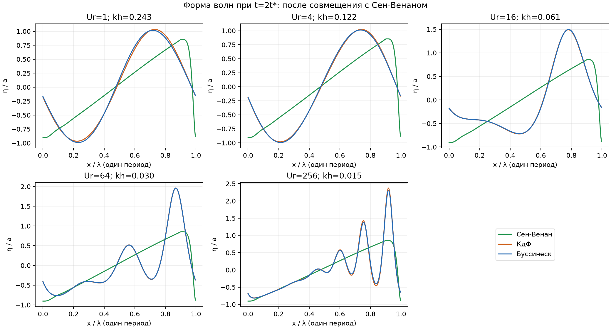
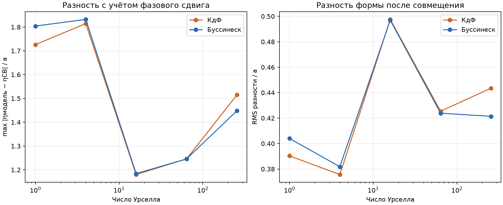
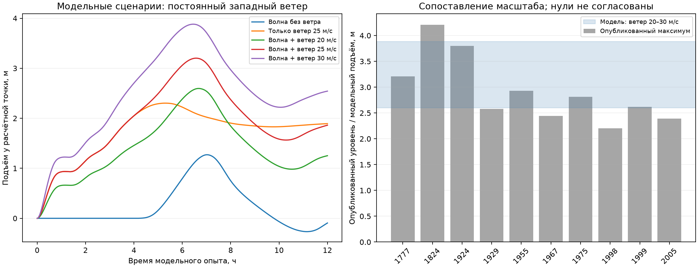
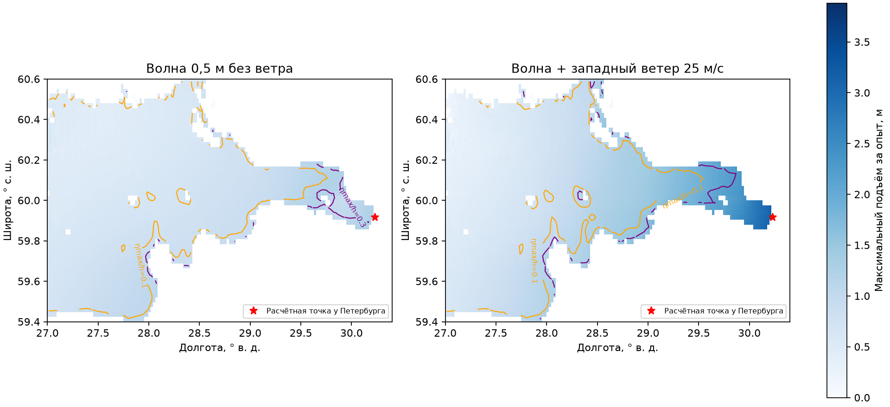
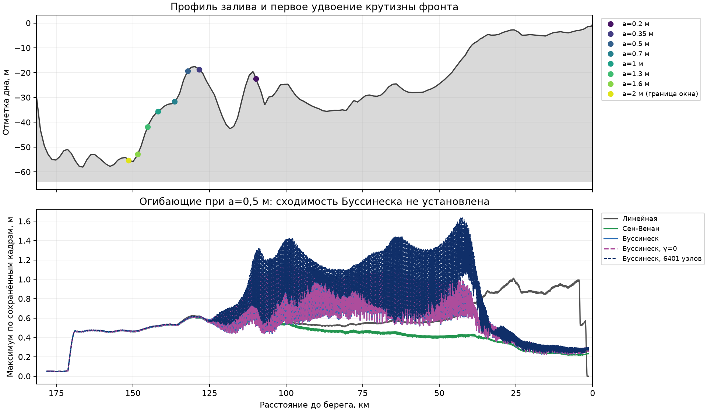

# Где нелинейность важна: результаты исследования

## Какой вопрос мы решали и какой ответ получили

Цель проекта — выяснить, **где при движении волны по Финскому заливу к Петербургу становится важно учитывать нелинейность**.

Линейная модель предполагает, что скорость волны не зависит от её высоты. Нелинейные модели учитывают, что гребень может двигаться быстрее нижней части волны. Из-за этого волна меняет форму: её передний склон становится круче. На мелководье изменение уровня также становится большим по сравнению с глубиной, и линейное приближение теряет основание.

**Полученный ответ: учитывать нелинейность нужно и при длительном движении волны через залив, и при большом подъёме воды на мелководье.** Это два разных механизма, которые показали наши расчёты:

- **Изменение формы накапливается по пути.** Для модельной волны с входной амплитудой 0,2 м и длиной 10 км линейный и нелинейный расчёты расходятся более чем на 10% входной амплитуды уже через 25 минут. Место наибольшей разницы в этот момент находится примерно в 134 км от берега Петербурга, на глубине около 25 м. Значит, заметное влияние нелинейности возможно ещё до Невской губы.
- **В Невской губе подъём становится сравним с глубиной.** В опыте с входной волной 0,5 м и западным ветром 25 м/с модель даёт подъём около 3,20 м у Петербурга при исходной глубине 4,41 м. Это примерно 73% глубины: считать такое изменение малым уже нельзя.
- **Дисперсия влияет на то, во что превращается крутой фронт.** Модель Сен-Венана даёт резкий переход уровня — бор. КдФ и Буссинеск вместо него могут давать последовательность отдельных гребней.

Эти выводы относятся к рассчитанным условиям. **Одну постоянную линию на карте, после которой любая волна становится нелинейной, мы не получили:** результат зависит от амплитуды, длины волны, пройденного пути и глубины.

Есть и нерешённый вопрос: расчёт Буссинеска на реальном профиле слишком сильно меняется при уточнении сетки. Поэтому точные высоты волн у берега по этой модели пока нельзя считать установленным результатом. Ниже показано, какие выводы подтверждены, а какие требуют дальнейшей работы.

## 1. Как мы определяли, что нелинейность стала важна

Одну и ту же начальную поверхность воды рассчитывали линейной моделью и моделью Сен-Венана. Затем в каждый момент находили самое большое различие уровней вдоль всего разреза.

По условию задания влияние нелинейности считается заметным, когда эта разница превышает **10% входной амплитуды**. Например, при амплитуде 0,2 м порог равен 0,02 м. Это выбранный в проекте критерий сравнения моделей; он не означает, что высота волны изменилась на 10% в каждой точке залива.

В формулах проекта это записано как `d(t) > 0,1`, а первый момент превышения называется `t₁₀`. Время определяется по сохранённым кадрам расчёта, поэтому оно имеет ограниченную точность.

На предыдущем этапе на ровном дне было получено: **чем выше начальная волна, тем быстрее появляется заметная разница**. Найденная зависимость близка к обратной пропорциональности: увеличение амплитуды примерно вдвое сокращает время примерно вдвое. Подробности и рисунки этого опыта — в [comparison.md](comparison.md).

## 2. Где это происходит на разрезе Финского залива

В расчёте использован профиль глубин GEBCO от западного края области через район Кронштадта к берегу Петербурга. Длина разреза — около 181 км. Защитная дамба не моделируется. Это приближённый залив без защитного сооружения, а не точное восстановление дна какого-либо исторического года.

В начальный момент в западной части разреза расположен пакет из трёх волн. Длина каждой волны — 10 км. Эта длина выбрана для вычислительного опыта, чтобы пакет помещался в области; она не взята из наблюдений конкретного наводнения. Проверены десять входных амплитуд от 0,2 до 2 м.

Ниже приведены четыре примера из этой серии. Расстояние отсчитывается **от найденной точки до берега Петербурга вдоль разреза**, а не от места запуска волны.

| Входная амплитуда | Когда разница впервые превысила 10% | Где была наибольшая разница в этот момент | Глубина в этой точке |
|---|---|---|---|
| 0,2 м | 25 мин | 133,9 км до берега | 24,8 м |
| 0,4 м | 17 мин 10 с | 142,2 км до берега | 36,0 м |
| 1 м | 8 мин 20 с | 155,7 км до берега | 56,4 м |
| 2 м | 4 мин 10 с | 161,6 км до берега | 53,9 м |

**Вывод:** в этих опытах более высокая волна начинает заметно отличаться от линейного расчёта раньше и дальше от берега. При этом расхождение появляется и на глубинах в десятки метров. Объяснять нелинейность только малой глубиной Невской губы было бы неверно.

Точка в таблице — место первого обнаруженного расхождения двух расчётов. Она не является постоянной границей для всего залива. Начальная волна занимает протяжённый участок, поэтому эти расстояния также нельзя считать расстоянием, которое прошёл один выбранный гребень.

Все десять результатов и проверки уточнением сетки сохранены в [compare_summary.json](results/compare_summary.json). На крайних амплитудах уточнение меняло время начала расхождения не более чем на 2%.

## 3. Зачем сравнивали Сен-Венан, КдФ и Буссинеска

После того как передний склон волны стал крутым, модели могут предсказывать разное дальнейшее поведение.

| Модель | Что она позволяет увидеть в этом сравнении |
|---|---|
| Сен-Венан | Укручение волны и появление бора — резкого перехода между уровнями воды |
| КдФ | Как дисперсия меняет укручение и приводит к появлению отдельных гребней; в проекте работает только на постоянной глубине |
| Буссинеск | Также учитывает дисперсию, но позволяет рассчитывать волны на переменной глубине и отражение |

**Дисперсия** означает, что составляющие волны с разными длинами распространяются с разными скоростями. Поэтому форма волны меняется иначе, чем в модели Сен-Венана.

Сначала все три модели сравнили на ровном дне. Так влияние изменения глубины не смешивается с различиями моделей. Глубина была 5 м, начальная амплитуда — 0,0075 м. Малую амплитуду выбрали, чтобы выполнить условия применимости КдФ и Буссинеска. Это проверочный опыт, а не описание реального волнения в заливе.

Менялась длина волны. Для характеристики опыта использовано **число Урселла**: оно связывает амплитуду, длину волны и глубину. В обозначениях теории `Ur = a·λ²/h³`. Число относится к начальной волне; оно помогает сравнивать действие нелинейности и дисперсии.

| Число Урселла | Длина начальной волны | Что видно у КдФ и Буссинеска к выбранному моменту сравнения |
|---|---|---|
| 1 и 4 | около 129 и 258 м | Профиль остаётся близким к синусоиде, тогда как у Сен-Венана передний склон уже резко укрутился |
| 16 | около 516 м | Появляется выраженный узкий гребень |
| 64 и 256 | около 1033 и 2066 м | Вместо одного резкого фронта видна последовательность гребней |



**Как читать рисунок.** Зелёная линия — Сен-Венан, оранжевая — КдФ, синяя — Буссинеск. На каждом графике показан один период волны. По горизонтали — положение внутри этого периода, по вертикали — уровень воды, делённый на начальную амплитуду. Например, значение 2 означает подъём вдвое больше начальной амплитуды.

Чтобы сравнить именно форму, кривые КдФ и Буссинеска сдвинуты вдоль горизонтальной оси относительно Сен-Венана. Иначе различие скоростей могло бы закрыть различие формы. Сдвиг сделан только при анализе рисунка; сами расчёты не изменялись.

Момент снимка выбран одинаковым по физическому смыслу: это удвоенное теоретическое время, за которое начальная синусоида должна образовать вертикальный фронт без дисперсии. В теории это время обозначено `t*`.

**Вывод:** учёт дисперсии действительно меняет результат. Причём большое число Урселла начальной волны не гарантирует, что дисперсией можно пренебрегать после укручения: у крутого фронта появляются более короткие волны. КдФ и Буссинеск в этой серии дают близкую форму. Проверка на вдвое более подробной сетке сохранила эту картину.



На левом графике измерена наибольшая разница с Сен-Венаном без сдвига кривых. Справа показана среднеквадратичная разница после сдвига — усреднённая по разрезу мера различия формы. Обе величины делятся на начальную амплитуду. Справа получено примерно 0,38–0,50: даже после совмещения волн отличие формы остаётся значительным. Это различие моделей, а не измеренная ошибка относительно реальной воды.

Полные численные таблицы находятся в [third_dispersion.json](results/third_dispersion.json).

## 4. Какой подъём воды получился у Петербурга

Следующий опыт использует двумерную карту глубин: вода движется по акватории залива, а не только вдоль одного разреза. Рассчитывается **нагон** — повышение уровня воды под действием приходящей длинной волны и ветра.

В модель с запада входит плавный подъём воды с максимальным значением 0,5 м и заданным масштабом длины 300 км. Сравниваются случаи без ветра и с постоянным западным ветром. Расчёт длится 12 часов. Учтены донное трение и вращение Земли; перепад атмосферного давления принят нулевым. Дамбы в модели нет.

**Это заданные условия вычислительного опыта.** Амплитуда 0,5 м и длина 300 км не восстановлены по наблюдениям исторических наводнений: таких входных данных в найденных источниках нет. Ветер 25–30 м/с встречается в описании наводнения 1975 года, но это описание не доказывает, что такой ветер постоянно действовал над всем заливом. Скорость 20 м/с добавлена для сравнения более слабого воздействия.

| Условия опыта | Максимальный подъём у расчётной точки возле Петербурга |
|---|---:|
| Нет входной волны и ветра — проверка покоя | 0 м |
| Только входная волна 0,5 м | 1,27 м |
| Только западный ветер 25 м/с | 2,30 м |
| Входная волна 0,5 м и ветер 20 м/с | 2,60 м |
| Входная волна 0,5 м и ветер 25 м/с | 3,20 м |
| Входная волна 0,5 м и ветер 30 м/с | 3,88 м |

Расчётная точка находится в ближайшей водной ячейке к выбранному месту у Петербурга. Глубина там 4,41 м. Из-за крупной сетки точка смещена примерно на 2,3 км; её нельзя считать точным положением исторического поста измерения уровня.

**Что это говорит о нелинейности.** Подъём 3,20 м составляет около 73% исходной глубины 4,41 м. Предположение о малом изменении уровня здесь не выполняется. Даже в опыте без ветра подъём 1,27 м составляет около 29% глубины. Это указывает на необходимость нелинейной модели в этой мелководной части залива.



**Слева** показано, как менялся уровень в пяти опытах с волной или ветром. Время отсчитывается от начала модельного опыта. **Справа** серые столбцы — опубликованные максимумы десяти наводнений: 1777, 1824, 1924, 1929, 1955, 1967, 1975, 1998, 1999 и 2005 годов. Голубая полоса показывает диапазон наших расчётов с волной и ветром 20–30 м/с.

В источниках максимумы находятся в диапазоне **2,20–4,21 м**, а в этих трёх расчётах — **2,60–3,88 м**. Получен сопоставимый масштаб подъёма воды. Но это ещё не подтверждение точности модели для каждого исторического наводнения.

Для такой проверки нужны ветер и входной уровень воды во времени для каждого события. Эти данные не найдены. Кроме того, исторические уровни отсчитывались от разных высотных нулей, поправки между которыми не установлены. Поэтому процент ошибки прогноза по этим столбцам не вычисляется.

Для 1924 года сохранено значение **3,80 м по МЧС**. Другая публикация даёт 3,69 м; это расхождение не устранено и отмечено в [gulf.md](gulf.md). Там же приведены источники всех десяти событий и исходные обозначения уровней.

## 5. В каких частях залива подъём велик по сравнению с глубиной



Цвет показывает наибольший подъём воды за весь опыт. Слева — входная волна без ветра, справа — та же волна с западным ветром 25 м/с. Красная звезда — расчётная точка у Петербурга.

Линии показывают, где подъём составляет 10% и 30% исходной глубины. Например, на глубине 4 м этим порогам соответствуют подъёмы 0,4 и 1,2 м. Это ориентир из теории: чем больше подъём по сравнению с глубиной, тем меньше оснований считать движение линейным.

Для волны без ветра подъём превышает 30% глубины на площади около **363 км²**. С ветром 25 м/с эта площадь увеличивается примерно до **767 км²**. Такие участки есть в Невской губе и на других мелководьях вдоль берегов. Поэтому утверждение «нелинейность важна только в Невской губе» расчётом не подтверждается.

Эти линии показывают отношение подъёма к глубине. Они не означают, что разница с линейным расчётом там обязательно равна 10% или 30%: линейной двумерной модели для такого сравнения в проекте нет.

## 6. Какой результат пока нельзя считать надёжным

**Принятая в проекте карта глубин размером 150 × 50 ячеек не менялась.** Она используется в двумерном расчёте нагона. Числа **3201 и 6401** ниже обозначают количество расчётных точек вдоль одномерного разреза залива. В обоих случаях глубины берутся из одного и того же подготовленного профиля; дополнительные точки не добавляют новых сведений о дне.

Расчёт на 6401 точке выполнен как **дополнительная проверка зависимости результата от шага вычислений**. `TASKS.md` не требует менять принятую карту ради этой проверки. Результат основного одномерного расчёта на 3201 точке сохранён, а выявленная чувствительность указывается как ограничение его надёжности.

На реальном профиле залива дополнительно сравнивались наибольшие уровни воды, достигнутые в каждой точке по линейной модели, Сен-Венану и Буссинеску. Такая кривая максимумов называется **огибающей**.



**Верхняя часть рисунка** показывает дно и места, где передний склон волны у Сен-Венана стал вдвое круче, чем в линейном расчёте. Это дополнительный способ увидеть изменение формы. Для входной амплитуды 0,5 м такая точка находится примерно в 132 км до берега. При уточнении сетки она сдвинулась примерно на 0,31 км. Эти отметки определены по крутизне, поэтому не совпадают с границей 10-процентного различия уровней из раздела 2.

**Нижняя часть** показывает кривые максимумов для входной амплитуды 0,5 м. Здесь обнаружена проблема: если увеличить число точек расчёта с 3201 до 6401, максимумы Буссинеска в отдельных местах меняются примерно на 1 м. Это вдвое больше входной амплитуды. Разница сохраняется при одинаковом времени сравнения и на глубинах от 5 м, то есть проблема касается не только самого берега.

Увеличение частоты сохранения результатов также заметно меняет эти кривые. Следовательно, **мы пока не установили, какие именно максимальные высоты Буссинеска на профиле близки к решению уравнений**. Выбрать более красивую кривую и назвать её правильной нельзя.

Есть ещё ограничение: у моделей различается положение условной береговой стенки. Поэтому сравнение проводилось до начала реакции этих границ. Оно не определяет точную высоту наката на сухой берег.

Проверено и объяснение через обрушение. В Буссинеске его приближённо учитывает дополнительное гашение волны. При выключении этого гашения результаты до реакции берега практически не изменились. Значит, объяснять различия на этом интервале именно его действием нельзя. Долю энергии, потерянную при обрушении или ушедшую в отражение, мы не определили: сохранённых уровней воды для такого баланса недостаточно.

Для получения надёжных высот по Буссинеску требуется отдельная работа с численным методом: проверить шаг времени, действие сглаживания и поведение при дальнейшем уточнении сетки. Численные значения проверок сохранены в [third_gulf.json](results/third_gulf.json) и [third_gulf_sampling.json](results/third_gulf_sampling.json).

## 7. Что можно сказать по итогам проекта

**На вопрос «где нелинейность важна?» получен ответ для исследованных условий:**

1. **По пути через залив** — когда разница скоростей разных частей волны успевает заметно изменить её форму. В наших опытах с длиной волны 10 км это происходит ещё на глубинах в десятки метров. Время и место зависят от входной амплитуды.
2. **В мелководной восточной части и на других прибрежных мелководьях** — когда подъём воды составляет значительную долю глубины. У расчётной точки возле Петербурга получено около 3,20 м подъёма при глубине 4,41 м в сценарии с ветром 25 м/с.
3. **После сильного укручения нужно учитывать возможность влияния дисперсии.** Расчёты КдФ и Буссинеска показывают последовательность гребней там, где Сен-Венан даёт бор. Выбор модели влияет на предсказываемую форму волны.

Третья волна дала сравнение моделей, сопоставление нагона со всеми десятью найденными историческими событиями и итоговые рисунки. Дополнительная проверка выявила ограничение надёжности высот Буссинеска на одномерном профиле. Это не требует менять согласованную карту 150 × 50 или отказываться от остальных выводов. Для завершения исследования в рамках задания результаты можно представить с этим явно указанным ограничением. Точные высоты Буссинеска на профиле и точность воспроизведения отдельных исторических наводнений при этом остаются неподтверждёнными.

Для доклада можно использовать выводы о месте появления различий, изменении формы волны и масштабе нагона. Заявлять точный прогноз исторических событий, точную высоту наката или универсальное завышение линейной модели «в четыре раза» оснований нет.

## Как повторить расчёты и где лежат данные

Из корня проекта:

```powershell
python -m analysis.third_wave
```

Скрипт строит пять рисунков этого отчёта. Параметры и численные результаты сохранены в `analysis/results/third_*.json`, массивы для повторного анализа — в одноимённых NPZ. Данные предыдущего этапа находятся в `compare_summary.json`. Описание батиметрии и ссылки на наблюдения — в [gulf.md](gulf.md), уравнения — в [теории](../docs/theory.md).

Для воспроизведения использованы следующие параметры:

| Опыт | Основные условия |
|---|---|
| Сравнение трёх моделей на ровном дне | Глубина 5 м; амплитуда 0,0075 м; пять длин волн из раздела 3; область из четырёх периодов; 1024 точки, контроль на 2048; 121 момент времени от начала до удвоенного времени `t*` |
| Дополнительное сравнение на профиле залива | Длина волны 10 км; амплитуды 0,2; 0,35; 0,5; 0,7; 1; 1,3; 1,6; 2 м; 3201 точка; 5 часов расчёта; сохранение через 25 с. Для 0,5 и 2 м — контроль на 6401 точке с сохранением через 12,5 с |
| Нагон на карте | Карта 150 × 50 ячеек; 12 часов; входная волна с максимумом 0,5 м и масштабом 300 км; западный ветер 0–30 м/с; донное трение 0,0025; вращение Земли учтено; перепад давления нулевой |

Проверки программы запускаются командой:

```powershell
python -m unittest analysis.test_compare analysis.test_third_wave
```

Все 17 проверок прошли. Они проверяют работу программы и способ сравнения результатов. Они не устраняют описанную проблему Буссинеска и не заменяют сравнение с полноценными наблюдениями наводнений.
