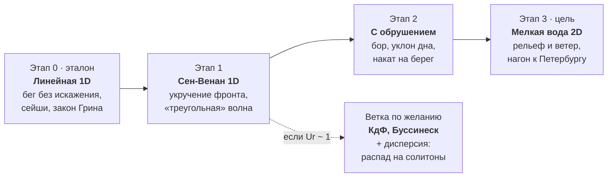

# Финский залив: теория длинных волн

**Итог.** Модели считаем по лестнице: 1D Сен-Венан (укручение, «треугольная» волна) → 1D Сен-Венан с обрушением и уклоном дна → 2D мелкая вода с рельефом залива. КдФ и Буссинеск — дополнительная ветка, которая показывает роль дисперсии. Ниже: откуда берутся эти модели, какие параметры определяют выбор между ними и какие числа получаются для Финского залива.

**Обозначения:** x — координата вдоль залива, t — время, h(x) — невозмущённая глубина, η(x,t) — отклонение поверхности, u — скорость течения, усреднённая по глубине, g ≈ 9,81 м/с².

---

## 1. Постановка и безразмерные параметры

Все модели ниже — упрощения одной задачи: потенциальное течение идеальной несжимаемой жидкости со свободной поверхностью. Потенциал скорости φ удовлетворяет уравнению Лапласа во всей толще воды:

$$
\Delta \varphi = 0, \qquad -h(x) < z < \eta(x,t)
$$

На дне вода не протекает. На поверхности выполнены кинематическое условие (частицы не покидают поверхность) и динамическое (давление равно атмосферному, интеграл Бернулли):

$$
\varphi_z + h_x \varphi_x = 0 \quad (z=-h); \qquad \eta_t + \varphi_x \eta_x = \varphi_z, \quad \varphi_t + \tfrac12 |\nabla\varphi|^2 + g\eta = 0 \quad (z=\eta)
$$

Задача нелинейна, и область заранее неизвестна, поэтому её упрощают. Как именно — решают три масштаба: глубина h₀, длина волны L и амплитуда a. Из них составляют два параметра:

$$
\varepsilon = \frac{a}{h_0} \;\; \text{(нелинейность)}, \qquad \mu = \left(\frac{h_0}{L}\right)^2 \;\; \text{(дисперсия)}
$$

Малое ε означает низкую волну: нелинейными членами можно пренебречь. Малое μ означает волну, длинную по сравнению с глубиной: давление гидростатическое, дисперсией можно пренебречь. Часто вместо μ пишут kh = 2πh₀/L; мелкая вода — это kh ≲ 0,3, то есть L ≳ 20 h₀.

Соотношение двух эффектов задаёт **число Урселла**:

$$
\mathrm{Ur} = \frac{\varepsilon}{\mu} = \frac{a L^2}{h_0^3}
$$

- **Ur ≫ 1** — нелинейность сильнее дисперсии: волна укручается и обрушивается.
- **Ur ~ 1** (точнее, порядка 10) — эффекты уравновешены: образуются солитоны и кноидальные волны, это область КдФ.
- **Ur ≪ 1** — волна почти линейна и диспергирует.

---

## 2. Иерархия моделей

Каждая следующая модель удерживает на один эффект больше. Все они получаются из постановки раздела 1 разложением по малым ε и μ.

### 2.1. Линейная теория мелкой воды (ε → 0, μ → 0)

Давление гидростатическое, нелинейных членов нет:

$$
\eta_t + (h u)_x = 0, \qquad u_t + g\,\eta_x = 0 \;\;\Longrightarrow\;\; \eta_{tt} = g\,(h\,\eta_x)_x
$$

При постоянной глубине это волновое уравнение с решением Даламбера η = F(x − c₀t) + G(x + c₀t) и скоростью c₀ = √(gh). Волна бежит, не меняя формы. Для сравнения, полная линейная теория даёт ω² = gk·tanh(kh). При kh → 0 это переходит в ω = c₀k, то есть дисперсии нет.

**Что описывает:** распространение, отражение, рефракцию, сейши, рост амплитуды на мелководье (закон Грина, раздел 4). **Чего нет:** укручения и обрушения.

### 2.2. Нелинейные уравнения мелкой воды, Сен-Венан (ε ~ 1, μ → 0)

Для полной глубины H = h + η, в консервативной форме (её и нужно дискретизировать методом конечных объёмов):

$$
H_t + (H u)_x = 0, \qquad (H u)_t + \left(H u^2 + \tfrac12 g H^2\right)_x = g\,H\,h_x
$$

При ровном дне у системы есть инварианты Римана, которые сохраняются вдоль характеристик:

$$
R_{\pm} = u \pm 2\sqrt{gH} = \text{const} \quad \text{вдоль} \quad \frac{dx}{dt} = u \pm \sqrt{gH}
$$

Возьмём волну, бегущую в одну сторону по покоящейся воде. Точка профиля с возвышением η движется со скоростью

$$
V(\eta) = 3\sqrt{g(h+\eta)} - 2\sqrt{gh} \;\approx\; c_0\left(1 + \frac{3\eta}{2h}\right)
$$

Гребень обгоняет подошву, передний склон становится круче, и через конечное время возникает вертикальный фронт (градиентная катастрофа). Дальше гладкого решения нет: появляется разрыв — бор, на котором теряется энергия. Это и есть модельное «обрушение». Синусоида при этом превращается в пилообразную («треугольную») волну.

**Что описывает:** укручение, бор, накат на берег. **Чего нет:** дисперсии, поэтому фронт всегда становится разрывом.

### 2.3. Уравнения Буссинеска (ε ≪ 1, μ ≪ 1, ε ~ μ)

К Сен-Венану добавляют первую поправку на негидростатичность давления. Форма Перегрина для переменной глубины:

$$
\eta_t + \left[(h+\eta)\,u\right]_x = 0, \qquad u_t + u u_x + g\,\eta_x = \frac{h}{2}\,(h\,u_t)_{xx} - \frac{h^2}{6}\,u_{xxt}
$$

При ровном дне правая часть равна (h²/3)·u_xxt, а дисперсионное соотношение

$$
\omega^2 = \frac{g h k^2}{1 + (kh)^2/3}
$$

приближает точное gk·tanh(kh) при малых kh. Короткие волны бегут медленнее длинных, поэтому фронт не обязательно рвётся: он может распасться на цепочку волн (ондулярный бор). Волны идут в обе стороны, переменное дно учитывается.

### 2.4. Уравнение Кортевега — де Фриза (ε ~ μ ≪ 1, одно направление)

Если волна бежит только вправо, уравнения Буссинеска сводятся к одному уравнению:

$$
\eta_t + c_0\,\eta_x + \frac{3 c_0}{2h}\,\eta\,\eta_x + \frac{c_0 h^2}{6}\,\eta_{xxx} = 0
$$

Третий член отвечает за нелинейность (укручение), четвёртый — за дисперсию (расплывание). Их баланс даёт уединённую волну — солитон:

$$
\eta = A\,\mathrm{sech}^2\!\left(\frac{x - Vt}{\Delta}\right), \qquad \Delta = \sqrt{\frac{4h^3}{3A}}, \qquad V = c_0\left(1 + \frac{A}{2h}\right)
$$

У солитона A·Δ²/h³ = 4/3, то есть число Урселла порядка единицы при любой амплитуде — это и означает баланс. Произвольный начальный импульс распадается на набор солитонов и хвост. Для медленно меняющейся глубины есть КдФ с переменными коэффициентами.

### 2.5. Двумерные уравнения мелкой воды (реалистичная модель залива)

Уравнения Сен-Венана на плоскости с рельефом h(x, y) и внешними силами:

$$
\eta_t + \nabla\cdot(H\mathbf{u}) = 0, \qquad \mathbf{u}_t + (\mathbf{u}\cdot\nabla)\mathbf{u} + f\,\mathbf{e}_z\times\mathbf{u} + g\nabla\eta = -\frac{\nabla p_a}{\rho} + \frac{\boldsymbol{\tau}_s}{\rho H} - C_f\,\frac{|\mathbf{u}|\,\mathbf{u}}{H}
$$

Здесь f = 2Ω·sin φ ≈ 1,26·10⁻⁴ с⁻¹ — параметр Кориолиса на широте 60°, p_a — атмосферное давление, τ_s — напряжение ветра на поверхности, C_f ≈ 0,002–0,003 — коэффициент донного трения. Ветер, давление и трение важны для нагонов к Петербургу.

### Сводка

| Модель | Предположения | Что видно в расчёте | Чего нет |
| --- | --- | --- | --- |
| Линейная мелкая вода | ε → 0, μ → 0 | бег без искажения, отражение, сейши, закон Грина | укручения, обрушения |
| Сен-Венан 1D | μ → 0, ε любое | укручение, «треугольная» волна, бор, накат | дисперсии |
| Буссинеск | ε ~ μ ≪ 1 | дисперсия + нелинейность, ондулярный бор, переменное дно | обрушения (нужен отдельный критерий) |
| КдФ | ε ~ μ ≪ 1, одно направление | солитоны, распад импульса | отражения, сильной нелинейности |
| Мелкая вода 2D | μ → 0 | рельеф и берег залива, ветер, Кориолис, нагон | дисперсии |

---

## 3. Время укручения и время дисперсии

Отношение этих двух времён равно числу Урселла. Какой эффект наступит раньше, тот и определяет судьбу волны.

**Нелинейное укручение.** Из формулы V(η) раздела 2.2 разница скоростей гребня и подошвы имеет порядок (3/2)·c₀·ε. Волна переворачивается, когда гребень догоняет подошву, то есть проходит относительно неё расстояние порядка L:

$$
t_{nl} \sim \frac{L}{\varepsilon\, c_0}
$$

Точно момент опрокидывания находится по пересечению характеристик. Для начального профиля η₀(x):

$$
t_* = \frac{2h}{3c_0\,\max(-\eta_0')}, \qquad \text{для синусоиды } \eta_0 = a\sin kx: \;\; t_* = \frac{L}{3\pi\,\varepsilon\, c_0}, \quad x_* = c_0 t_* = \frac{L}{3\pi\,\varepsilon}
$$

С этой величиной удобно сверить расчёт этапа 1: вертикальный фронт в численном решении должен появиться в момент t*.

**Дисперсия.** По дисперсионному соотношению Буссинеска фазовая скорость c ≈ c₀(1 − (kh)²/6): короткие гармоники отстают. Профиль заметно расплывается, когда отставание накапливается до длины волны. Из баланса членов КдФ (η_t против (c₀h²/6)·η_xxx):

$$
t_{d} \sim \frac{6L^3}{c_0 h^2} \sim \frac{L}{\mu\, c_0}
$$

**Сравнение.** Отношение времён:

$$
\frac{t_d}{t_{nl}} \sim \frac{\varepsilon}{\mu} = \mathrm{Ur}
$$

- **Ur ≫ 1:** укручение наступает намного раньше дисперсии, волна обрушивается; достаточно Сен-Венана.
- **Ur ~ 1–30:** эффекты сравнимы; нужна КдФ или Буссинеск, и вместо обрушения возникают солитоны.
- **Ur ≪ 1:** доминирует дисперсия; волна почти линейная.

Ещё t_nl стоит сравнить со временем прохождения залива L_зал / c₀. Если волна дойдёт до конца раньше, чем успеет укрутиться, нелинейность можно не учитывать.

---

## 4. Влияние уклона дна

На мелеющем и сужающемся дне длинная волна растёт по закону Грина, пока не выполнится критерий обрушения.

### 4.1. Закон Грина

Пусть дно меняется медленно на масштабе длины волны, волна не отражается и энергия не теряется. Тогда поток энергии через сечение сохраняется. Энергия на единицу площади E = ρgA²/2, групповая скорость на мелкой воде c_g = √(gh), ширина канала b(x):

$$
E\, c_g\, b = \text{const} \;\;\Longrightarrow\;\; A \propto h^{-1/4}\, b^{-1/2}
$$

При b = const остаётся классический закон Грина A ∝ h^(−1/4). Длина волны при этом сокращается как L ∝ √h. Поэтому крутизна A/L и параметр ε = A/h растут быстрее амплитуды: ε ∝ h^(−5/4).

Закон применим, если уклон пологий: L·|h_x| / h ≪ 1. При крутом уклоне часть волны отражается, а при ε → 1 нарушается линейность.

**Пример для залива (ориентировочно).** Глубина падает с 38 м до 4 м: множитель (38/4)^(1/4) ≈ 1,76. Ширина сужается со 100 км до 15 км: множитель (100/15)^(1/2) ≈ 2,6. Вместе амплитуда вырастает примерно в 4,5 раза. Именно поэтому восточная часть залива и Невская губа особенно уязвимы для нагонов.

### 4.2. Критерии обрушения

1. **По отношению высоты к глубине** (Мак-Кауэн): волна обрушивается при H/h ≈ 0,78. Это главный практический критерий для кода. В зависимости от уклона наблюдаемые значения лежат примерно в диапазоне 0,6–1,2. Предельная уединённая волна в полной теории Эйлера имеет A/h ≈ 0,83.
2. **Кинематический:** скорость частиц на гребне достигает фазовой скорости, u ≥ c. В модели Сен-Венана это момент градиентной катастрофы t* из раздела 3.
3. **По числу Ирибаррена:** определяет тип обрушения на откосе с углом β:

$$
\xi = \frac{\tan\beta}{\sqrt{H/L_0}}, \qquad L_0 = \frac{g T^2}{2\pi}
$$

   При ξ < 0,5 обрушение скользящее (пена по склону), при 0,5 < ξ < 3,3 — ныряющее (гребень заворачивается), при ξ > 3,3 — накатывающееся (волна взбегает почти без обрушения).

4. **Для длинной волны на плоском откосе** (Кэрриер — Гринспен): синусоидальная волна с частотой ω накатывает без обрушения, если

$$
Br = \frac{\omega^2 R}{g\,\alpha^2} < 1,
$$

   где R — вертикальная высота наката, α — угол уклона.

**Как это учитывается в модели.** В Сен-Венане обрушение получается само: метод конечных объёмов, который корректно обрабатывает разрывы, превращает фронт в бор и рассеивает на нём энергию. В Буссинеске разрыва нет, поэтому критерий добавляют вручную. Там, где H/h > 0,78 или фронт слишком крутой, включают искусственную вязкость или локально переходят на уравнения Сен-Венана.

---

## 5. Оценки для Финского залива

Для всех длинных волн залива Ur ≫ 1 и дисперсия несущественна. Поэтому основная модель — уравнения мелкой воды, а КдФ и Буссинеск нужны только для коротких волн у берега.

Геометрия залива (ориентировочно, требует уточнения по батиметрическим данным): длина около 400 км, ширина 70–130 км, средняя глубина около 38 м, максимальная около 120 м, в Невской губе 3–5 м. Отсюда c₀ = √(g·38) ≈ 19 м/с.

| Сценарий | a, м | L | h, м | ε | Ur | t_nl по порядку (точное x* для синусоиды) | t_d | Какая модель |
| --- | --- | --- | --- | --- | --- | --- | --- | --- |
| Нагон, средняя часть залива | 1 | 200 км | 20 | 0,05 | 5·10⁶ | ≈ 80 ч (≈ 420 км) | ≈ ∞ | линейная или Сен-Венан |
| Нагон в Невской губе | 2 | 50 км | 4 | 0,5 | 8·10⁷ | ≈ 4,4 ч (≈ 11 км) | ≈ ∞ | только Сен-Венан |
| Основная сейша залива | 0,5 | 1600 км | 38 | 0,013 | 2·10⁷ | ≈ 1750 ч | ≈ ∞ | линейная |
| Тестовая волна для этапов 1–2 | 0,5 | 5 км | 20 | 0,025 | 1,6·10³ | ≈ 4 ч (≈ 21 км) | ≈ 6200 ч | Сен-Венан |
| Демонстрация солитонов | 0,5 | 500 м | 20 | 0,025 | 16 | ≈ 24 мин (≈ 2 км) | ≈ 6 ч | КдФ или Буссинеск |
| Ветровая волна у берега | 1 | 38 м | 3 | 0,33 | 54 | ≈ 21 с | ≈ 19 мин | Буссинеск + критерий обрушения |

Формулы: t_nl = L/(ε·c₀); x* = L/(3π·ε) для синусоиды; t_d = L/(μ·c₀). «≈ ∞» означает больше 10⁸ ч.

**Три вывода из таблицы:**

- Нагон в средней части залива слабо нелинеен: опрокидывание наступило бы лишь на расстоянии около 420 км, то есть порядка всей длины залива. Решающей нелинейность становится в Невской губе, где ε ≈ 0,5 и x* ≈ 11 км.
- Обычные ветровые волны в открытом заливе (период 6–8 с, длина 60–100 м, kh > 1) не являются волнами на мелкой воде. Ни одна модель из иерархии к ним не применима, кроме как в прибрежной зоне.
- Проверка разумности: основная сейша залива как бассейна, открытого с одного конца, имеет период T = 4L/c₀ ≈ 23 ч. Это близко к наблюдаемым колебаниям системы Балтика — Финский залив с периодом около суток. Радиус деформации Россби c₀/f ≈ 150 км сравним с шириной залива, поэтому в 2D-модели сила Кориолиса нужна.

### 5.1. Параметры по умолчанию в `backend/contract.py`

Сейчас по умолчанию заданы a = 0,5 м, длина волны 20 м, глубина 5 м. При таких значениях kh ≈ 1,57: это **не мелкая вода** (нужно kh ≲ 0,3). Модели этапов 0–3 к такой волне неприменимы, ей нужна полная дисперсионная теория. Для мелкой воды при глубине 5 м длина волны должна быть от 100 м.

| a, м | Длина волны, м | h, м | kh | ε | Ur | t* (x*) для синусоиды | Вывод |
| --- | --- | --- | --- | --- | --- | --- | --- |
| 0,5 | 20 | 5 | 1,57 | 0,1 | 1,6 | — | не мелкая вода, модели не подходят |
| 0,5 | 100 | 5 | 0,31 | 0,1 | 40 | ≈ 15 с (≈ 106 м) | граница мелкой воды, укручение видно |
| 0,5 | 200 | 5 | 0,16 | 0,1 | 160 | ≈ 30 с (≈ 212 м) | мелкая вода, Сен-Венан |

**Предложение:** для этапов 0–2 по умолчанию взять длину волны 100–200 м и область L не меньше 3–5 длин волны (например, 1000 м). Тогда опрокидывание фронта попадает в расчётную область, а t_end = 30–60 с хватает, чтобы его увидеть.

---

## 6. Какую модель считать и почему

Считаем не одну модель, а лестницу из четырёх этапов: каждый добавляет один эффект и проверяется по предыдущему.

Финальная модель — двумерная мелкая вода без дисперсии, потому что для длинных волн залива Ur ≫ 1 (раздел 5).

1. **Этап 0. Линейная 1D,** η_tt = g(h·η_x)_x. Нужна как эталон: у неё есть точные решения (Даламбер, закон Грина, сейша T = 4L/c₀), и на них проверяется код. Схема — явная, «крест».
2. **Этап 1. Сен-Венан 1D, ровное дно.** Начальное условие — тестовая волна из таблицы (a = 0,5 м, L = 5 км, h = 20 м). Фронт укручается, профиль становится «треугольным». Проверка: вертикальный фронт должен появиться около t* ≈ 25 мин (x* ≈ 21 км).
3. **Этап 2. Сен-Венан 1D с уклоном дна и обрушением.** Метод конечных объёмов (схема Русанова или HLL) с источником g·H·h_x. Дно — продольный профиль залива или наклонная плоскость. Волна растёт по закону Грина, обрушивается при H/h ≈ 0,78, дальше бежит бор и накатывает на берег.
4. **Этап 2б, по желанию. КдФ или Буссинеск.** Короткая волна с Ur ≈ 16 распадается на солитоны, а не обрушивается. Это показывает, почему для длинных волн залива дисперсией можно пренебречь.
5. **Этап 3. Мелкая вода 2D на реальном рельефе** (GEBCO или EMODnet) с ветром, давлением, трением и Кориолисом. Результат: карта уровня воды, нагон в Невской губе, вклад сужения залива (множитель b^(−1/2)).

**Почему не сразу 2D:** в двумерной модели ошибку кода не отличить от физики, а у этапов 0–2 есть аналитические ответы для проверки.

**Шаг по времени.** Для всех явных схем он ограничен условием Куранта: Δt ≤ C·Δx / max(|u| + √(gH)), C < 1. Например, при Δx = 100 м и h = 40 м шаг не больше 5 с.

---

## 7. Открытые вопросы и литература

### Открытые вопросы

- [ ] Какое явление моделируем в первую очередь: свободную волну (импульс, синусоиду) или ветровой нагон к Петербургу?
- [ ] Для этапов 1–2 достаточно продольного 1D-сечения залива с реальным профилем глубины h(x)?
- [ ] Нужна ли ветка с дисперсией (КдФ, Буссинеск), если для длинных волн залива Ur ≫ 1?
- [ ] Какое условие ставить на западной открытой границе: свободный выход волны или заданный уровень Балтики?
- [ ] Хватит ли критерия H/h ≈ 0,78 для обрушения или нужно моделировать бор?
- [ ] Нужно ли сравнивать результат с реальными наблюдениями уровня (например, с наводнением в Кронштадте)?

### Литература

1. Уизем Дж. Линейные и нелинейные волны. — М.: Мир, 1977. Мелкая вода, характеристики, КдФ, Буссинеск.
2. Стокер Дж. Волны на воде. — М.: ИЛ, 1959. Классический вывод теории мелкой воды и теории боров.
3. Пелиновский Е. Н. Гидродинамика волн цунами. — Н. Новгород: ИПФ РАН, 1996. Закон Грина, накат, критерии обрушения.
4. Peregrine D. H. Long waves on a beach // J. Fluid Mech., 1967. Уравнения Буссинеска для переменной глубины.
5. Carrier G. F., Greenspan H. P. Water waves of finite amplitude on a sloping beach // J. Fluid Mech., 1958. Накат на откос.
6. Battjes J. A. Surf similarity // Proc. 14th Coastal Engineering Conf., 1974. Число Ирибаррена и типы обрушения.
7. Kennedy A. B. et al. Boussinesq modeling of wave transformation, breaking, and runup // J. Waterway, Port, Coastal and Ocean Eng., 2000. Обрушение в моделях Буссинеска.
8. LeVeque R. J. Finite Volume Methods for Hyperbolic Problems. — Cambridge, 2002. Численные схемы для уравнений Сен-Венана.
9. Батиметрия залива: GEBCO, EMODnet Bathymetry (открытые данные).
